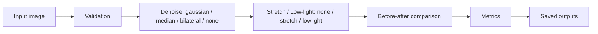

# Day 10 — Image Denoising & Enhancement (14 October 2026)

Rudra Edge Aerospace · RE-T1 (Spectra) · Task: **Image Denoising & Enhancement** (Contrast Stretching + Low-Light Denoising)

## Objective
Reduce noise in images (Gaussian-like and salt-and-pepper), expand useful contrast, and improve visibility of dark
images — using **classical image processing only** (OpenCV + NumPy). No AI model is trained or used.

## Methods
- **Gaussian blur** – weighted-average smoothing; good for Gaussian-like noise, blurs edges.
- **Median blur** – replaces each pixel by neighbourhood median; best for salt-and-pepper noise.
- **Bilateral filter** – smooths while weighting by intensity similarity, so strong edges are mostly kept; slower.
- **Contrast stretching** – percentile-based linear mapping (default 1st–99th percentile → 0–255). Colour images:
  only luminance (Y of YCrCb) is stretched so hue is preserved. Constant images are returned unchanged (no divide-by-zero).
- **Low-light enhancement** – contrast stretch → gamma brightening (LUT) → optional CLAHE on luminance.
  Denoising runs *before* this step so noise is not amplified. Defaults: gamma 0.8, CLAHE clip 1.5, 8×8 tiles.

## Architecture


## Files
| File | Purpose |
|---|---|
| `image_enhancement.py` | Validation, filters, stretching, low-light, metrics, `run_pipeline()` |
| `generate_samples.py` | Deterministic synthetic samples + clean reference |
| `run_day10.py` | CLI (no args = all synthetic samples) |
| `tests/test_day10.py` | 12 automated tests (unittest; pytest also works) |
| `samples/`, `outputs/` | Generated inputs / results (one sub-folder per sample) |

## Dependencies
`opencv-python`, `numpy`; optional `scikit-image` (SSIM only — reported as `null` if missing); optional `pytest`.

## Run (Windows PowerShell)
```powershell
cd path\to\Rudra-RE-T1\Day10
python -m pip install opencv-python numpy scikit-image
python run_day10.py                                   # all synthetic samples -> .\outputs\<sample>\
python run_day10.py --input .\samples\low_light.png --reference .\samples\clean_reference.png --denoise bilateral --enhance lowlight --output-dir .\outputs\custom
python -m unittest tests.test_day10 -v                # or: python -m pytest tests -v
```
CLI options: `--denoise {none,gaussian,median,bilateral}`, `--enhance {none,stretch,lowlight}`, `--ksize N` (odd), `--reference PATH`.

## Outputs (per run folder)
`original.png` (copy of input), `denoised.png`, `enhanced.png`, `comparison.png` (side by side),
`run_summary.json` (methods, params, size, time, paths), `quality_metrics.json` (stats + PSNR/SSIM when a reference exists).
The input file is never modified; a run that would overwrite its own input is refused.

## Actual results (synthetic 256×256 samples, run in the build environment)
Tests: **12 / 12 passed** (`python -m unittest tests.test_day10`, ~0.5 s).

| Sample | Pipeline | PSNR vs clean: input → denoised → final (dB) | SSIM: input → denoised → final |
|---|---|---|---|
| gaussian_noise | bilateral + stretch | 20.39 → 27.58 → 24.59 | 0.249 → 0.509 → 0.469 |
| salt_pepper_noise | median + stretch | 17.50 → 24.03 → 18.57 | 0.268 → 0.897 → 0.757 |
| low_contrast | gaussian(3) + stretch | 14.77 → 14.64 → 13.96 | 0.815 → 0.778 → 0.746 |
| low_light | bilateral(σc=15) + lowlight | 7.00 → 7.00 → 15.23 | 0.157 → 0.189 → 0.571 |

How to read this honestly:
- Denoising clearly improved PSNR/SSIM on both noise types. The following stretch *lowered* PSNR/SSIM against the clean
  reference for those samples because it changes intensity mapping (the reference was never stretched). That is a limit of
  using a pixel-wise metric on a contrast change, not proof the image got worse — and not proof it got better.
- low_contrast: contrast (std 11.6 → 67.4) rose a lot, yet PSNR/SSIM vs the original clean scene fell slightly. More contrast ≠ better quality.
- low_light: large gain in visibility and in PSNR/SSIM vs the bright reference. Gamma/CLAHE defaults were chosen by
  trying a few settings on this one synthetic scene, so they may not suit real photos.

## Limitations
- Percentile stretching is global; one bright or dark region can dominate. Clipping loses detail at the extremes.
- Bilateral/Gaussian smooth fine texture; median can erase thin lines; strong CLAHE can show blotchy noise in flat dark areas.
- Synthetic noise is simpler than real sensor noise (no demosaicing, compression or colour noise).
- Only 8-bit grayscale/BGR; 16-bit input is scaled to 8-bit; alpha is dropped.

## Possible improvements
Non-local means or BM3D denoising, Retinex-style illumination estimation, adaptive (local) stretching, automatic parameter
selection, and evaluation on real low-light photos with a no-reference metric.
