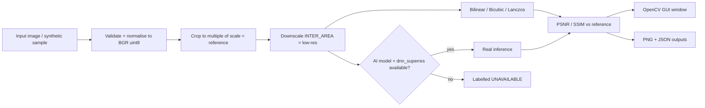

# Day 11 - Image Super-Resolution Workbench (Rudra Edge Aerospace)

## Objective
Build a working super-resolution prototype that compares three classical interpolation methods
(bilinear, bicubic, Lanczos) and, when a compatible pretrained model is present, a real AI model,
in an interactive OpenCV GUI window, with metrics and files saved for later inspection.

## What is super-resolution?
Super-resolution (SR) produces a higher-resolution image from a lower-resolution one.

| | Traditional interpolation | AI-based SR (EDSR, ESPCN, FSRCNN, LapSRN) |
|---|---|---|
| Idea | Fixed mathematical kernel estimates new pixels from neighbours | Neural network trained on many LR/HR pairs predicts plausible detail |
| Needs | Nothing | Pretrained weights (`*.pb`) + OpenCV `dnn_superres` |
| Speed | Sub-millisecond to a few ms here | Much slower (not measured here, see Limitations) |
| Detail | Cannot add detail; smooths or rings at edges | Can restore sharper edges/texture, but may hallucinate |

## Architecture


## Environment this was built and tested in
Linux sandbox: Python 3.13.16, NumPy 2.5.3, OpenCV 5.0.0 (Qt5 GUI backend). Only OpenCV and NumPy are required.
The Windows PowerShell commands below were written for your machine but **have not been run on Windows**.

## Install (Windows PowerShell)
```powershell
cd .\rudra_day11
python -m venv .venv
.\.venv\Scripts\Activate.ps1
pip install opencv-contrib-python numpy
```
Install only one OpenCV package (`opencv-contrib-python`). The sandbox had `opencv-python`, `opencv-contrib-python`
and `opencv-python-headless` installed together; there `cv2.dnn_superres` was an empty namespace, so AI SR was unavailable.

## Run
```powershell
# Built-in synthetic test image, 4x
python .\sr_workbench.py

# Your own image (PNG/JPG/JPEG), 2x
python .\sr_workbench.py .\my_photo.jpg --scale 2

# Custom output folder
python .\sr_workbench.py .\my_photo.jpg --scale 4 --out .\outputs\my_run
```
Options: `--scale 2..8`, `--out DIR`, `--model-dir DIR` (repeatable), `--repeats N` (timing runs),
`--require-ai` (exit code 3 before opening the GUI if real AI super-resolution is unavailable),
`--no-gui` (explicit opt-out, for automated tests only), `--selftest-close-after SEC` (smoke tests).
If no window can be created, the program prints the real error, still saves the files, and exits with code 2.
It never silently falls back to saving without displaying.

## GUI controls
| Key | Action |
|---|---|
| `q` / `Esc` / window close button | Close safely |
| `o` | Pick another image (needs tkinter, included with the standard Windows Python installer) |
| `2` `3` `4` | Re-process at that scale |
| `v` | Toggle detail view (nearest-neighbour zoom of the most detailed region, where the methods visibly differ) |
| `w` `a` `s` `d` | Move the zoom region (detail view) |

The window is resizable; images are letterboxed for display only, never stretched, and saved files are unscaled.

## AI super-resolution
Two things are needed: (1) an OpenCV build that has `dnn_superres` (`pip install opencv-contrib-python`, and no
other OpenCV package next to it), and (2) pretrained weights named `EDSR_x4.pb`, `LapSRN_x4.pb`, `FSRCNN_x2.pb`,
`ESPCN_x3.pb`, etc. in `models\` (or set `SR_MODEL_DIR`). The file's scale must equal `--scale`.
Preference order: EDSR, LapSRN, FSRCNN, ESPCN. The AI panel and `ai_super_resolution.png` appear only after
inference succeeds and returns the correct size.

```powershell
powershell -ExecutionPolicy Bypass -File .\get_models.ps1     # fetches FSRCNN/ESPCN/EDSR x2 and x4 into .\models
python .\sr_workbench.py --scale 4 --require-ai               # fails loudly if AI is not actually running
```
`get_models.ps1` is **untested**: the sandbox blocks GitHub (HTTP 403), so the download URLs were written from the
upstream repositories OpenCV's tutorial points to and could not be checked. If a download fails the script prints the
repository page to fetch the file from by hand. File naming (`EDSR_x4.pb`, `setModel("edsr", 4)`) follows the
[OpenCV dnn_superres tutorial](https://docs.opencv.org/4.x/d5/d29/tutorial_dnn_superres_upscale_image_single.html).

**Status: real AI inference has never been executed by me.** No weights exist on the build machine and both pypi.org and
GitHub were denied by the sandbox proxy. What *was* verified with the real contrib build of `cv2.dnn_superres`:
the class exists, and a corrupt model file raises a genuine `cv2.error` that the app reports as "AI unavailable".

## Outputs (`outputs\day11\`)
`original.png` (reference crop), `low_resolution.png`, `bilinear_x4.png`, `bicubic_x4.png`, `lanczos_x4.png`,
`comparison.png`, `run_summary.json`, `quality_metrics.json`, `sample_input.png` (synthetic runs),
`ai_super_resolution.png` (only after real AI success).

### Measured results (synthetic 640x480 test image, one run; times vary)
| Scale | Method | PSNR (dB) | SSIM | Time (ms, median of 5) |
|---|---|---|---|---|
| 4x | Bilinear | 18.48 | 0.6560 | ~0.3 |
| 4x | Bicubic | 18.97 | 0.6767 | ~0.3 |
| 4x | Lanczos | 18.94 | 0.6588 | ~2.7-3.3 |
| 2x | Bilinear | 22.96 | 0.8807 | ~0.4 |
| 2x | Bicubic | 24.74 | 0.9176 | ~0.4 |
| 2x | Lanczos | 25.07 | 0.9185 | ~3.2 |

PSNR/SSIM are reference-based: each result is compared with the clean original at identical size, with the
low-res input made by `INTER_AREA` downscaling. SSIM uses an 11x11 Gaussian window (sigma 1.5), averaged over channels.
These numbers come from one synthetic image with sharp lines and text; they do not predict results on real low-quality photos,
and larger output size says nothing about quality.

## Tests
```powershell
python -m unittest discover -s tests -v
```
Actual results in the sandbox (37 tests, stdlib `unittest`):
- Default sandbox OpenCV (empty `dnn_superres`), no display: 37 run, 34 passed, **3 blocked/skipped**
  (real window test; real-library corrupt-model test; real inference test).
- Contrib build of OpenCV + virtual X display (Xvfb): 37 run, 36 passed, **1 blocked/skipped**
  (`test_12h_REAL_inference_with_local_models`, because no weights exist). This run executed the real window
  open/close test and the real-library corrupt-model test.
- The AI success path is otherwise tested with a **mock** engine (plumbing only). Failure paths (no model, corrupt model,
  wrong scale, wrong output shape, `--require-ai` exit code 3) are tested.
- Once `.\models` has real weights, `test_12h` runs automatically and exercises real inference.

## Limitations
- The GUI was verified only on a virtual display (Xvfb) with a Qt-backed OpenCV, not on a physical Windows desktop.
- No pretrained weights available -> AI inference untested end to end (AI quality and timing numbers do not exist yet);
  AI timing is a single run when it works.
- No git repository was present in the workspace, so existing project files, logs and conventions could not be reviewed or reused.
- 16-bit images are reduced to 8-bit; alpha channels are dropped; grayscale is processed as 3-channel.
- Very large images are processed at full size (slow Lanczos); only the display is scaled.
