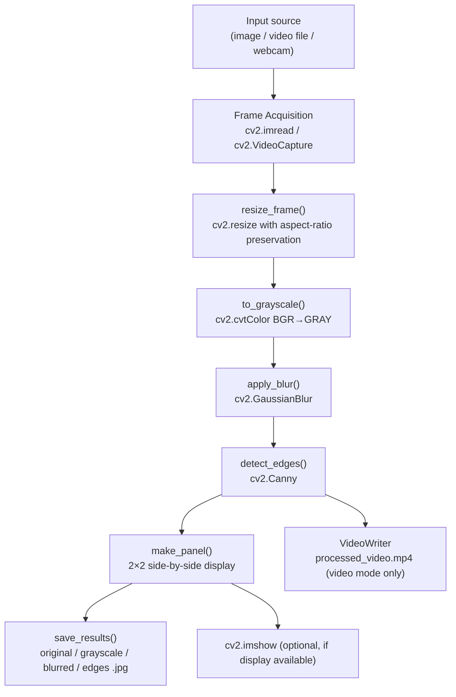
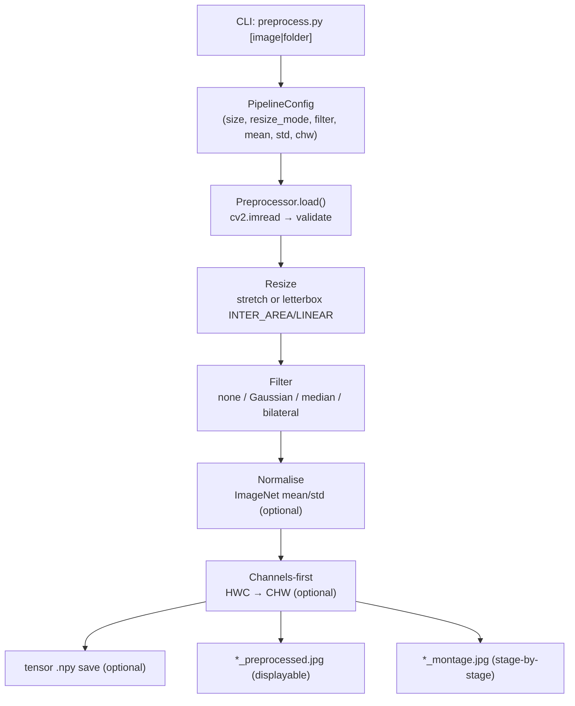
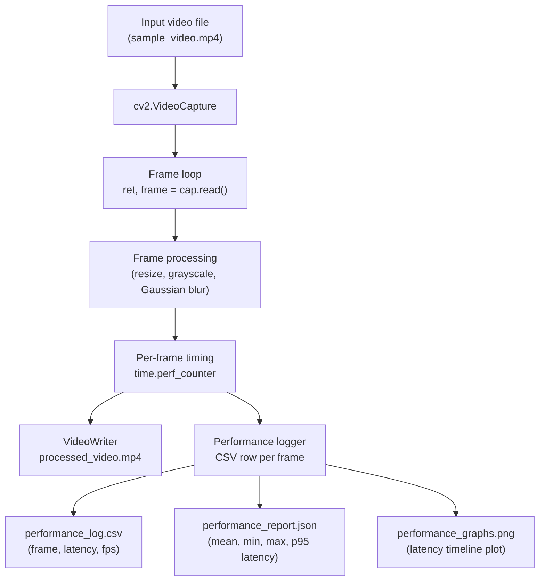
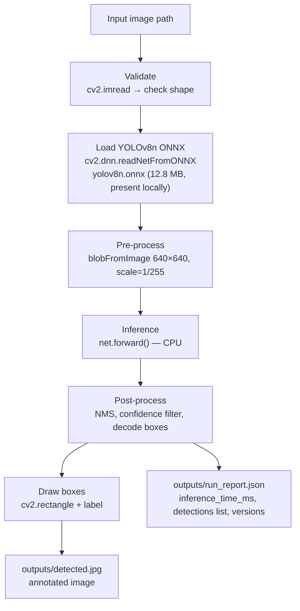
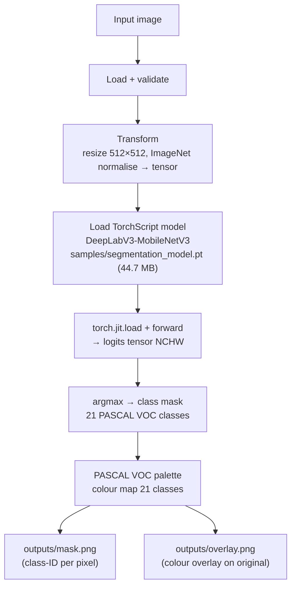
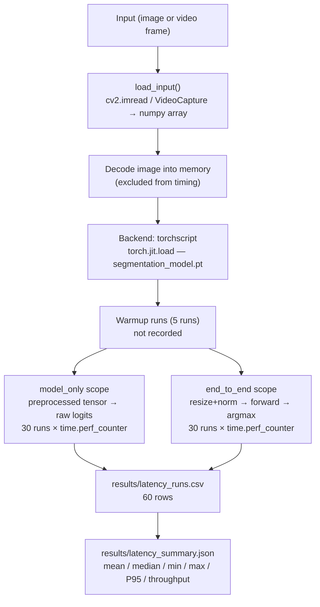
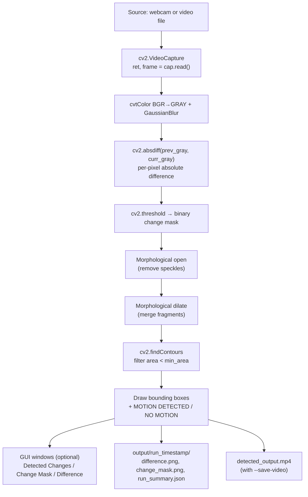
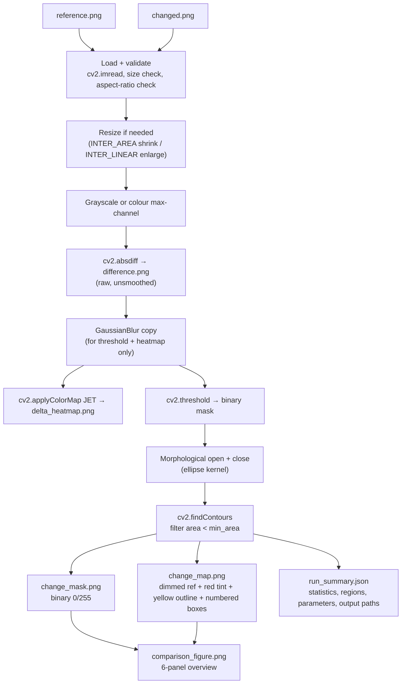
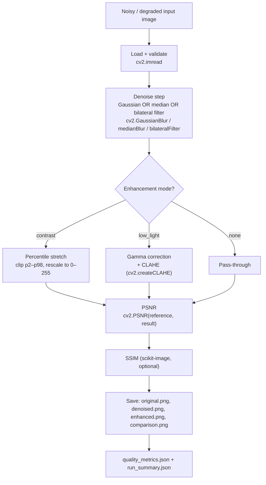
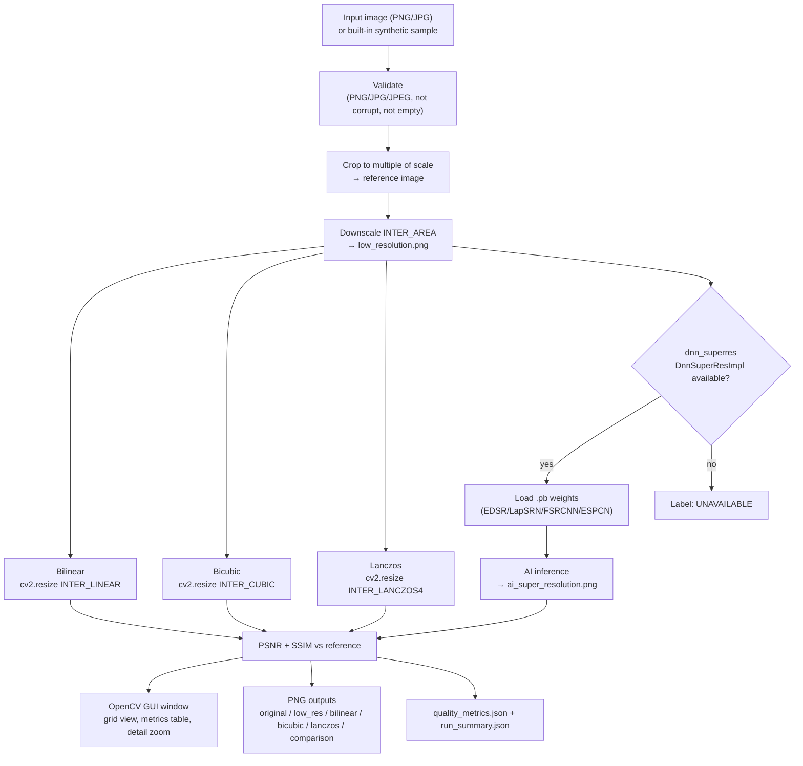

# Architecture — Rudra Edge Aerospace | RE-T1 (Spectra)

**Prepared:** 16 October 2026  
**Task:** Day 12 — Final Documentation & Package  
**Scope:** Days 2–11 (all implemented modules)

---

## Overview

This project is a collection of standalone Computer Vision modules, each corresponding to one training day. They do not share a common runtime or configuration file. Each day's folder is self-contained with its own source code, dependencies, inputs, and outputs.

The common architectural principle across all modules is:

```
Input (file / webcam / synthetic)
  → Input Validation (existence, format, decodability)
  → Image / Frame Preprocessing
  → Core CV Algorithm
  → Analysis / Metrics (where applicable)
  → Result Visualisation (OpenCV GUI, optional)
  → Output Saving (image files, video, JSON, CSV)
  → Summary / Report
```

---

## Module-by-Module Architecture

---

### Day 2 — OpenCV CV Starter Pipeline (`cv_pipeline.py`)



**Entry point:** `python Day2/cv_pipeline.py [--mode image|video|webcam] [--input FILE]`  
**Outputs:** `Day2/output/` — 4 JPEG snapshots + optional video  
**Dependencies:** `opencv-python`, `numpy`

---

### Day 3 — Image Preprocessing Pipeline (`preprocess.py` + `preprocessing/`)



**Entry point:** `python Day3/preprocess.py input/test.jpg --filter gaussian --montage`  
**Outputs:** `Day3/output/` — preprocessed JPG, montage JPG, optional `.npy`  
**Dependencies:** `opencv-python`, `numpy`

---

### Day 4 — Video Stream Processing (`video_processor.py`)



**Entry point:** `python Day4/video_processing/video_processor.py`  
**Outputs:** `Day4/output/` — processed video, CSV log, JSON report, performance graph  
**Dependencies:** `opencv-python`, `numpy`

---

### Day 5 — Object Detection Pipeline (`object_detection.py`)



**Entry point:** `python Day5/object_detection.py --image images/test.jpg --confidence 0.25`  
**Model:** `Day5/yolov8n.onnx` — locally available (12.8 MB)  
**Real result:** 5 detections (4×person, 1×bus), 236.23 ms CPU inference  
**Outputs:** `Day5/outputs/` — `detected.jpg`, `run_report.json`  
**Dependencies:** `opencv-python`, `numpy` (ONNX route uses OpenCV DNN, not ultralytics)

---

### Day 6 — Semantic Segmentation (`semantic_segmentation.py`)



**Entry point:** `python Day6/semantic_segmentation.py`  
**Model:** `Day6/samples/segmentation_model.pt` — locally available (44.7 MB)  
**Outputs:** `Day6/outputs/` — `mask.png`, `overlay.png`  
**Dependencies:** `torch`, `torchvision`, `numpy`, `Pillow`

---

### Day 7 — Inference Latency Benchmark (`benchmark_latency.py`)



**Entry point:** `python Day7/benchmark_latency.py`  
**Real results:** Model-only mean 1307 ms, end-to-end mean 2299 ms (30 runs, CPU, Intel i7)  
**Dependencies:** `numpy`, `opencv-python`, `torch` (torchscript backend), `onnxruntime` (onnx backend, optional)

---

### Day 8 — Temporal Image Analysis (`temporal_analysis.py`)



**Entry point:** `python Day8/temporal_analysis.py --video samples/moving.mp4 --no-gui`  
**Outputs:** `Day8/output/run_YYYYMMDD_HHMMSS/`  
**Dependencies:** `opencv-python`, `numpy`

---

### Day 9 — Visual Change Detection (`visual_change_detection.py`)



**Entry point:** `python Day9/visual_change_detection.py [--headless]`  
**Real result:** 3 regions, 11909 changed pixels, 3.88% area (640×480 image)  
**Outputs:** `Day9/output/` — 7 PNG files + JSON  
**Dependencies:** `opencv-python`, `numpy`, `matplotlib` (optional)

---

### Day 10 — Image Denoising & Enhancement (`image_enhancement.py`)



**Entry point:** `python Day10/run_day10.py` or `python Day10/image_enhancement.py`  
**Real results:** Gaussian noise: PSNR 20.39→27.58 dB; Salt-pepper: 17.50→24.03 dB; Low-light: 7.00→15.23 dB  
**Outputs:** `Day10/outputs/{sample_type}/`  
**Dependencies:** `opencv-python`, `numpy`, `scikit-image` (optional)

---

### Day 11 — Super-Resolution Workbench (`sr_workbench.py`)



**Entry point:** `python Day11/sr_workbench.py [image.jpg] [--scale 2|4] [--out DIR]`  
**AI path status:** BLOCKED — `dnn_superres` weights not available; code path implemented and failure is reported cleanly  
**Real results (4×, synthetic image):** Bilinear PSNR=22.92/SSIM=0.857, Bicubic PSNR=23.51/SSIM=0.868, Lanczos PSNR=23.53/SSIM=0.852  
**Outputs:** `Day11/outputs/day11/`  
**Dependencies:** `opencv-python` or `opencv-contrib-python` (latter needed for AI path), `numpy`

---

## Cross-Cutting Design Patterns

| Pattern | Applied In |
|---------|-----------|
| Graceful headless fallback (no display → save to disk, no crash) | Day2, Day8, Day9, Day11 |
| Sample/synthetic data generator (zero-download first run) | Day2, Day4, Day8, Day10, Day11 |
| JSON run report (input, config, results, versions) | Day4, Day5, Day7, Day8, Day9, Day10, Day11 |
| `time.perf_counter()` for high-resolution timing | Day7, Day11 |
| `--no-gui` / `--headless` / `--no-display` CLI flag | Day8, Day9, Day11 |
| `unittest` (not pytest) for all test suites | Day3, Day5, Day7, Day8, Day9, Day10, Day11 |
| Clean CLI error messages + non-zero exit codes on failure | Day2, Day5, Day8, Day9, Day11 |
| Model files stored locally (no internet required at run time) | Day5 (yolov8n.onnx), Day6/Day7 (segmentation_model.pt) |

---

## Data Flow Between Days (None — Modules Are Independent)

Each day's module is completely standalone. There is no shared config file, shared database, or shared library package between days. Outputs from one day are not consumed as inputs by another day's pipeline (except that `Day7/samples/segmentation_model.pt` is a copy of `Day6/samples/segmentation_model.pt`).

---

## Known Architectural Gaps

| Gap | Impact |
|-----|--------|
| No shared `src/` or `lib/` package | Code duplication (e.g., input validation logic repeated across days) |
| No project-level `requirements.txt` | Each day must be set up independently |
| No CI/CD pipeline | Tests must be run manually per day |
| AI SR path never tested end-to-end | Cannot confirm AI quality numbers |
| GUI untested on physical Windows display | Possible issues with high-DPI or different OpenCV backends |
