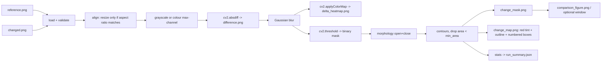

# Day 9 — Visual Change Detection
**Rudra Edge Aerospace · RE-T1 (Spectra) · 13 October 2026 · Deliverable: Change Map**

## 1. Objective
Offline, classical (no AI model) pipeline that compares a *reference* image with a *changed* image, produces a raw difference, a delta heatmap, a binary change mask and a final **Change Map**, plus statistics.

## 2. What is Visual Change Detection?
Pixel-wise comparison of two aligned images of the same scene. Large per-pixel intensity differences mean "something changed". Raw differences contain sensor/compression noise, so the result is thresholded and cleaned (blur, morphology, minimum region area).

## 3. Pipeline architecture


## 4. Algorithms and parameters
| Step | Method | Parameter (CLI) | Default |
|---|---|---|---|
| Difference | `cv2.absdiff` on grayscale (or max over B,G,R with `--color`) | `--color` | grayscale |
| Noise smoothing | `cv2.GaussianBlur` (only on the copy used for threshold/heatmap; `difference.png` stays raw) | `--blur` (0/1 = off) | 5 |
| Threshold | `cv2.threshold(..., THRESH_BINARY)` — pixel > T becomes 255 | `--threshold` | 30 |
| Morphology | ellipse kernel, OPEN then CLOSE | `--morph` (0 = off) | 3 |
| Small-region filter | contour area below limit is discarded | `--min-area` | 50 |
| Resize policy | changed image resized to reference size only if aspect ratio differs < 2 %; `INTER_AREA` when shrinking, `INTER_LINEAR` when enlarging; otherwise error | `--force-resize` | off |
| Heatmap | JET colormap on fixed 0–255 scale (0 = no change, so heatmaps are comparable between runs) | — | — |

Originals are never modified (all processing is on copies).

## 5. Folder structure
```
Day9/
  README.md
  DAILY_LOG_DAY9.md               (engineering daily log)
  visual_change_detection.py
  tests/test_change_detection.py
  input/     reference.png, changed.png (default input source)
  samples/   reference.png, changed.png
  output/    reference_preview.png, changed_preview.png, difference.png, delta_heatmap.png,
             change_mask.png, change_map.png, comparison_figure.png, run_summary.json
```

## 6. Environment
Python 3.12, OpenCV 4.13, NumPy 2.4, Matplotlib 3.10 (optional — without it a plain OpenCV tile figure is saved). No pytest needed (`unittest`). No installs, no network, ₹0.

## 7. PowerShell commands
Run from the repository root (adjust if your Day13 folder lives elsewhere):
```powershell
cd .\Day13

# 1. Generate synthetic samples (scenarios: single | multi | identical | noisy) - fixed seeds
python visual_change_detection.py --generate-samples multi

# 2. Run detection (opens a window if a GUI exists; press any key to close)
python visual_change_detection.py

# 3. Headless (no window; comparison_figure.png is still saved)
python visual_change_detection.py --headless

# 4. Custom parameters / custom images
python visual_change_detection.py --reference .\samples\reference.png --changed .\samples\changed.png --threshold 40 --blur 7 --morph 5 --min-area 100 --color --headless

# 5. Generate + run in one go
python visual_change_detection.py --generate-samples noisy --run --headless

# 6. Tests
python -m unittest discover -s tests -v
```
Note: `--generate-samples` overwrites `samples/reference.png` and `samples/changed.png` in Day13 only. Use `--samples-dir` to write elsewhere. Running detection writes only the 8 named files in `output/`.

## 8. Output images
| File | Meaning |
|---|---|
| `reference_preview.png` / `changed_preview.png` | Inputs as used by the pipeline (changed one is resized only if needed) |
| `difference.png` | Raw absolute difference (grayscale, brighter = bigger change) |
| `delta_heatmap.png` | Smoothed difference in JET colours (blue = none, red = large) |
| `change_mask.png` | Binary mask, 255 = changed, after threshold + cleanup |
| `change_map.png` | **Final deliverable**: dimmed reference, changed pixels tinted red, yellow outline, green numbered boxes |
| `comparison_figure.png` | 6-panel figure of everything above |
| `run_summary.json` | Statistics, regions (x,y,w,h,area), parameters, output paths |

## 9. Test cases and actual results
Executed in the development sandbox (Linux, Python 3.12): `python -m unittest discover -s tests -v` → **18 tests, OK**.

| Case | Status | Evidence |
|---|---|---|
| A. Identical images | PASS | changed pixels = 0, regions = 0 |
| B. Known rectangle (300,300)-(400,380) | PASS | 1 region, IoU with expected box > 0.85; with colour mode, blur/morph off the mask equals the rectangle exactly (8181 px) |
| B2. Area % | PASS | total 307200 px; percent = changed/total×100 checked to 4 decimals |
| C. Multiple regions | PASS | 3 regions detected (default settings); run on shipped samples: 11909 px, 3.8766 %, regions at (541,250), (300,303), (66,346) |
| D. Noise (σ=12, seed 42) | PASS | false pixels outside true box: 15980 (12907 regions) unfiltered vs **0** (1 region) with blur+morph+min-area |
| E. Invalid input | PASS | missing file, empty file, corrupt file, `.txt` → `ChangeDetectionError`; CLI prints `ERROR: ...`, exit code 2, no traceback |
| Resize policy | PASS | 320x240 vs 640x480 resized, original array unchanged; 400x100 rejected, accepted with `--force-resize` |
| Outputs valid | PASS | all PNGs decode, 480x640, mask values only {0,255}; change-map red dominance inside the box, not outside; output dir auto-created |
| Repeated runs / no collateral writes | PASS | 2 runs into a temp dir, unrelated file untouched, exactly the 8 expected files |
| Visual inspection of `comparison_figure.png` | PASS | all 3 changes outlined and numbered in the Change Map |
| Headless mode | PASS | `--headless` run completes, no window |
| GUI window mode | NOT RUN | sandbox has no display; only the fallback was verified (prints "no GUI available", still saves the figure). Please test on your Windows PC |
| PowerShell execution on Windows | NOT RUN | tested with the same Python commands on Linux only |

## 10. Known limitations
- **Grayscale mode can miss colour-only changes.** In the sample, the red rectangle has gray luminance ≈ 76, close to parts of the background (28–115), so the top edge of region #2 is ragged and incomplete (6396 px found vs 8181 true). `--color` fixes it (8545 px, +4.5 % from blur spreading).
- Blur spreads mask edges by about 2 px.
- Assumes images are already registered (no alignment for camera shift, rotation, lighting change).
- Fixed global threshold; no adaptive/illumination normalization.

Possible improvements: image registration (ORB + homography) before differencing, SSIM-based comparison, adaptive thresholding, colour as default.

## 11. Problems Encountered and How They Were Resolved
1. **Two of my own first-run tests failed** (16 run, 2 failed). (a) Area-% test expected the grayscale mask to match the inserted rectangle within 10 %; real result was ~20 % off. Cause found by measuring: grayscale luminance of the red box is similar to parts of the background, so some pixels fall under the threshold. Resolution: area-exactness test now uses colour mode with blur/morph off (exact 8181 px), and the grayscale behaviour is kept as a documented limitation with its own test. (b) Noise test used a hand-picked "10× fewer pixels" ratio that was a poor metric (the true box is included in both counts). Resolution: measure false pixels outside the true box instead (15980 vs 0).
2. No other problems occurred.
